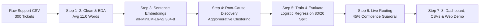

# Automated Customer Support Root-Cause Discovery & Ticket Routing

An end-to-end Natural Language Processing (NLP) and Machine Learning pipeline—paired with an interactive browser simulator—that transforms raw, unlabeled customer support messages into structured operational categories and routes incoming tickets automatically with built-in confidence guardrails.

> **Live Interactive Web Demo:** [https://vinaya-2003.github.io/support-ticket-root-cause-router/](https://vinaya-2003.github.io/support-ticket-root-cause-router/)

---

## Business Problem & Economic Value

Customer support teams receive thousands of unstructured messages daily. Manual reading and tagging slow down response times, hide emerging product glitches until refund requests pile up, and waste hours of staff labor.

This project solves both halves of the problem in a single automated workflow:
1. **Unsupervised Root-Cause Discovery:** Automatically reads historical tickets by semantic meaning—not rigid keywords—and groups recurring complaints into clear operational buckets without requiring pre-labeled training data.
2. **Supervised Ticket Routing & Guardrails:** Trains a lightweight classifier on those discovered buckets to route new incoming messages in milliseconds, while automatically flagging low-confidence edge cases (`< 45%` confidence) for human review.

---

## Architecture & Pipeline Flow



---

## Interactive Web App Demo (`index.html`)

Explore the live model behavior directly in your browser at **[vinaya-2003.github.io/support-ticket-root-cause-router](https://vinaya-2003.github.io/support-ticket-root-cause-router/)**:
* **Historical Cluster Breakdown:** Visualizes the top discovered root-cause themes and ticket volumes from the 300-ticket dataset.
* **Dynamic Confidence Guardrail Slider:** Adjust the minimum auto-route threshold (`25%` to `85%`) in real time to see how stricter or looser thresholds shift tickets between **Auto-Route** and **Human Review**.
* **Live Ticket Triage Simulator:** Type custom customer messages or test one-click presets (e.g., card declines, pending transfers, FX rate questions, and out-of-domain edge cases) to observe instant classification and confidence scoring.

---

## Technical Stack, Models & Algorithms

| Pipeline Component | Model / Tool Used | Purpose & Why It Was Chosen |
| :--- | :--- | :--- |
| **Data Processing & EDA** | `Pandas` | Cleans whitespace/duplicates and computes ticket length distributions (`mean = 11.0 words`, `range = 4–47 words`). |
| **Feature Engineering** | `all-MiniLM-L6-v2` (`Sentence-Transformers`) | Converts unstructured sentences into **384-dimensional normalized dense vectors** that capture semantic meaning rather than exact word matches. |
| **Unsupervised Clustering** | `AgglomerativeClustering` (`metric="cosine"`, `linkage="average"`, `distance_threshold=0.55`) | Discovers problem clusters automatically from the bottom up without requiring a pre-guessed cluster count ($K$). |
| **Cluster Auto-Labeling** | `TfidfVectorizer` | Extracts the top 3 highest-scoring descriptive keywords per cluster to generate human-readable category names. |
| **Supervised Classifier** | `LogisticRegression` (`max_iter=1000`) | Learns decision boundaries over the 384-d embeddings to predict categories for brand-new unseen customer messages. |
| **Visualization & Web UI** | `Matplotlib` & Vanilla `HTML/CSS/JS` | Generates a 2-panel executive dashboard alongside a standalone browser simulator (`index.html`). |

---

## Dataset & Experimental Results

### 1. Dataset & Train/Test Split (`PolyAI/banking77`)
* **Total Ingested & Clean Tickets:** `300` real-world customer banking queries (`raw_customer_tickets.csv`).
* **Exploratory Metrics:** Average length of `11.0 words` per ticket (minimum `4 words`, maximum `47 words`).
* **Unsupervised Discovery:** Identified **15 distinct problem clusters** across the 300 tickets.
* **Model Training & Validation Split:** Filtered to recurring themes with $\ge 4$ examples (`288` eligible tickets) and split **80% Training (`230` tickets)** / **20% Validation (`58` tickets)** using stratified sampling.
* **Validation Accuracy on Unseen Test Tickets:** **`100.0%`**

### 2. Top Discovered Root-Cause Clusters
| Discovered Problem Theme | Ticket Count | Share of Top 5 Volume |
| :--- | :---: | :---: |
| `CARD / LINK / NEW` | 89 | 31.9% |
| `EXCHANGE / RATE / RATES` | 77 | 27.6% |
| `PENDING / CASH / WITHDRAWAL` | 40 | 14.3% |
| `CURRENCIES / FIAT / CURRENCY` | 39 | 14.0% |
| `STATEMENT / FEE / EXTRA` | 34 | 12.2% |

### 3. Live Inference & Business Guardrail Test
New unseen messages are scored and routed against a **`45.0%` minimum confidence threshold**:

| New Incoming Customer Ticket | Predicted Route | Confidence | Operational Action |
| :--- | :--- | :---: | :--- |
| *"I tried paying at the grocery store but my card got rejected twice."* | `CARD / LINK / NEW` | `56.4%` | **Auto-Route** |
| *"Why is my bank transfer still pending after three days?"* | `PENDING / CASH / WITHDRAWAL` | `65.1%` | **Auto-Route** |
| *"Someone used my card in another city without my permission!"* | `CARD / LINK / NEW` | `67.0%` | **Auto-Route** |
| *"My cat walked across my keyboard and ordered a toaster."* *(Edge Case)* | `CARD / LINK / NEW` | `39.8%` | **Human Review** |

---

## Repository Structure & Quickstart

### Files in This Repository
* `ticket_root_cause_pipeline.ipynb` — Complete 8-step Google Colab / Jupyter notebook for data ingestion, EDA, clustering, training, validation, and visualization.
* `index.html` — Interactive web simulator deployed at [https://vinaya-2003.github.io/support-ticket-root-cause-router/](https://vinaya-2003.github.io/support-ticket-root-cause-router/).
* `raw_customer_tickets.csv` — Raw ingested dataset (`300` rows) saved prior to preprocessing.
* `clustered_historical_tickets.csv` — Full dataset enriched with `Cluster_ID`, `Problem_Theme`, and `Word_Count`.
* `live_ticket_predictions.csv` — Inference report containing `Predicted_Route`, `Confidence_%`, and `Action` flags.

### How to Run Locally
* **Run the Interactive Web Demo:**
  ```bash
  start index.html
  ```
* **Run the Python ML Pipeline:**
  ```bash
  pip install pandas matplotlib datasets sentence-transformers scikit-learn
  jupyter notebook ticket_root_cause_pipeline.ipynb
  ```